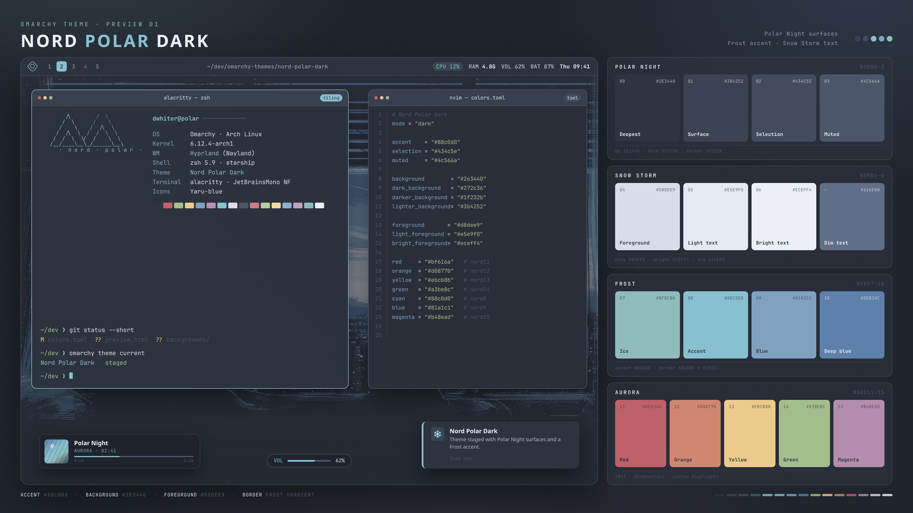

# Nord Polar Dark

A custom [Omarchy](https://omarchy.org/) theme built from Arctic Ice Studio's
**Nord** palette, with a custom Polar Night surface ramp and a Frost cyan accent.



## Palette

| Slot | Color | Nord |
|------|-------|------|
| background | `#2e3440` | nord0 |
| dark_background | `#272c36` | darker surface |
| darker_background | `#1f232b` | deepest surface |
| lighter_background | `#3b4252` | nord1 |
| foreground | `#d8dee9` | nord4 |
| accent | `#88c0d0` | nord8 |
| selection | `#434c5e` | nord2 |
| muted | `#4c566a` | nord3 |
| active border | `#88c0d0` → `#81a1c1` | nord8 → nord9 |

Aurora colors (nord11–nord15) fill the ANSI red/yellow/orange/green/magenta
slots. Bright ANSI variants are lifted from the same palette.

## Install

Install directly from this repository:

```bash
omarchy theme install https://github.com/<your-user>/nord-polar-dark.git
omarchy theme set "Nord Polar Dark"
```

Or clone it into your user themes directory and apply it:

```bash
git clone https://github.com/<your-user>/nord-polar-dark.git \
  ~/.config/omarchy/themes/nord-polar-dark
omarchy theme set "Nord Polar Dark"
```

## Preview

`preview.png` is the switcher-sized 1800×1012 board. `preview-large.png` is the
3200×1800 render for inspecting detail.

To regenerate after editing `colors.toml` or `preview.html`:

```bash
./render-preview.sh
```

The script uses headless Chromium and ImageMagick. The swatch values in
`preview.html` are written out for accuracy; when a color in `colors.toml`
changes, update the matching swatch and CSS variable in the preview as well.

## Backgrounds

This theme bundles 37 wallpapers:

- 3 from Omarchy's stock Nord theme
- 4 from Omarchy's stock Osaka Jade theme
- 30 additional custom wallpapers

Wallpapers keep their original authorship and licenses; they are included here
so the theme looks the same out of the box. Check the original sources before
redistributing them. The theme configuration itself lives in `colors.toml` and
does not depend on any particular wallpaper.

## Files

| File | Purpose |
|------|---------|
| `colors.toml` | Theme palette and Hyprland border settings |
| `backgrounds/` | Bundled wallpapers |
| `icons.theme` | Icon theme name |
| `neovim.lua` | Neovim colorscheme configuration |
| `vscode.json` | VS Code Nord extension |
| `preview.html` | Source for the preview board |
| `preview.png` | Switcher-sized preview |
| `preview-large.png` | High-resolution preview |
| `render-preview.sh` | Re-renders the preview images |

## Notes

When installed through `omarchy theme install`, Omarchy may regenerate
code-bearing files such as `neovim.lua` and `vscode.json` from `colors.toml`.
The copies in this repository are kept so the theme also works as a regular
user-authored theme in `~/.config/omarchy/themes/`.
